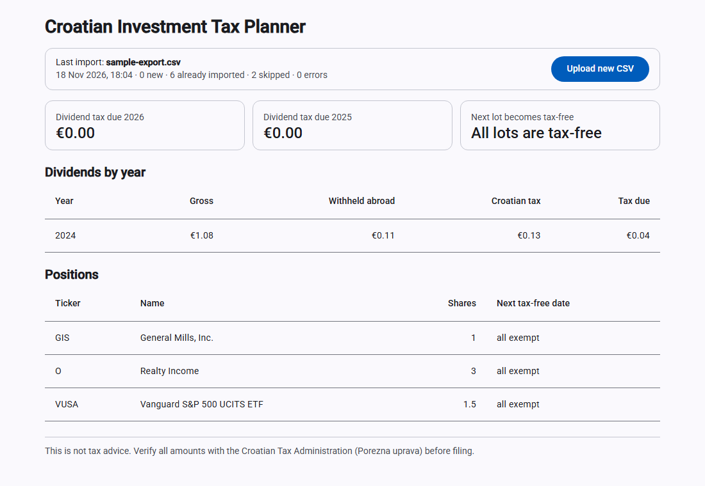

# Croatian Investment Tax Planner

[](https://github.com/dandrlon/croatia-investment-tax-planner/actions/workflows/ci.yml)

A web app for Croatian retail investors who use Trading 212. Upload your transaction history CSV export to get:

- **Dividends** per year and per position, with the 12% Croatian tax owed after credit for tax already withheld abroad.
- **The exemption date of every purchase lot.** Gains on shares held for more than two years are exempt from capital gains tax. Lots are matched FIFO.
- **The estimated capital gains tax if you sold everything today**, at prices you supply (through the API).

> **This is not tax advice. Verify all amounts with the Croatian Tax Administration (Porezna uprava) before filing.**



## Tech stack

- ASP.NET Core Web API on .NET 10, with OpenAPI and Swagger UI
- Entity Framework Core 10 with SQL Server 2022
- Angular 22 with Angular Material, served by nginx
- xUnit v3 unit tests, plus integration tests against a real SQL Server started with Testcontainers
- Vitest unit tests for the Angular services, helpers and components
- Docker Compose to run the UI, the API and the database with one command
- GitHub Actions to build and test on every push

## Quick start

You need [Docker Desktop](https://www.docker.com/products/docker-desktop/).

```bash
cp .env.example .env        # then edit the password in .env
docker compose up --build
```

Open <http://localhost:8080> and click **Upload new CSV**. To try it without your own data, upload `tests/TaxPlanner.Core.Tests/Fixtures/sample-export.csv`.

Importing the same file again, or a newer export that overlaps an older one, is safe: rows that are already stored are counted as duplicates and skipped. Data is kept in a Docker volume between runs.

### Using the API directly

Swagger is at <http://localhost:8080/swagger>:

1. `POST /api/imports`: upload your Trading 212 CSV export.
2. `GET /api/imports/latest`: the last import and its counts (`204` before the first import).
3. `GET /api/dividends`: dividends and tax per year. Add `?year=2025` for one year.
4. `GET /api/positions`: open positions, their lots and each lot's exemption date.
5. `POST /api/positions/tax-estimate`: send current prices in EUR per share, keyed by ISIN:

   ```json
   { "pricesEur": { "IE00B3XXRP09": 101.25, "US7561091049": 52.10 } }
   ```

## Exporting from Trading 212

In the Trading 212 app, go to **History → Export history**, choose the full date range, include orders and dividends, and download the CSV. Your account currency must be EUR.

## Running the tests

Back end: you need the [.NET 10 SDK](https://dotnet.microsoft.com/download), and Docker running for the integration tests.

```bash
dotnet test
```

Front end: you need [Node.js 26](https://nodejs.org/).

```bash
cd src/TaxPlanner.Web
npm ci
npx ng test --watch=false
```

## Developing the UI

Start the database and the API with Docker, then run the Angular dev server. It forwards `/api` to `localhost:8080`.

```bash
docker compose up -d
cd src/TaxPlanner.Web
npm ci
npx ng serve
```

Open <http://localhost:4200>. Changes reload automatically.

## Project structure

```
src/
  TaxPlanner.Core            Domain types, tax rules and the CSV parser. No database or web dependencies.
  TaxPlanner.Infrastructure  EF Core DbContext, mappings and migrations.
  TaxPlanner.Api             Controllers, import service, OpenAPI and Swagger.
  TaxPlanner.Web             Angular UI, plus its nginx image.
tests/
  TaxPlanner.Core.Tests      Unit tests for every tax rule and the parser.
  TaxPlanner.Api.Tests       HTTP-level tests against SQL Server in Docker.
```

The tax rules live in `Core` as plain static functions over lists of transactions, so each rule can be tested in isolation and read without knowing anything about the web or the database. The API stores only the imported transactions and computes every report from them on request.

## Front end

The UI is one page in `src/TaxPlanner.Web/src/app`:

- `api/`: the response types and `TaxApiService`, the only place that calls the API.
- `shared/`: plain functions that format amounts and dates and pick values for the page, such as the next lot to become tax-free.
- `import-bar/`, `warnings-panel/`, `summary-tiles/`, `dividends-table/`, `positions-table/`: small components that only display what they are given.
- `dashboard/`: loads the last import and both reports, and reloads them after an upload.

**The UI never calculates tax.** Every amount comes from the API as it is; the UI only formats it and chooses which values to show.

In Docker, nginx serves the built app and forwards `/api`, `/swagger` and `/openapi` to the API, so the browser talks to a single origin and no CORS setup is needed.

## Tax rules

All rules, their status and their known limitations are documented in [docs/tax-rules.md](docs/tax-rules.md).

## Roadmap

1. **Phase 1 (done):** Web API, CSV import, dividend tax, exemption dates, tax estimate, tests, Docker Compose, CI.
2. **Phase 2 (done):** Angular UI with file upload, dividends by year, and positions with their exemption dates.
3. **Phase 3:** deployment to Azure.
